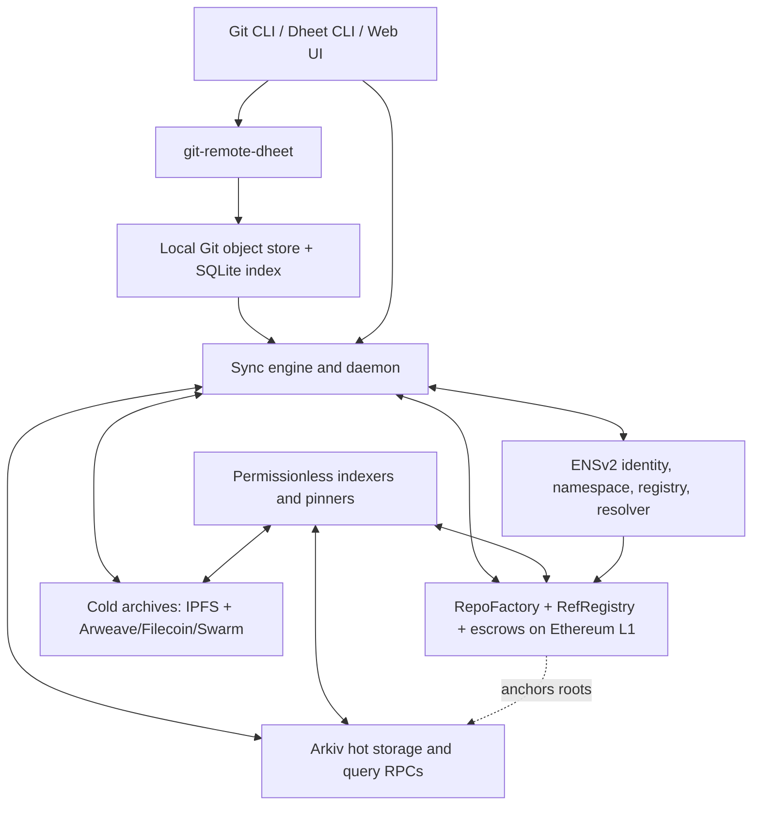
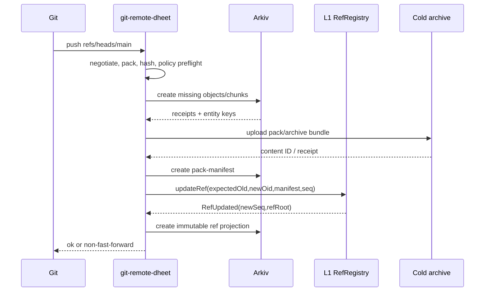
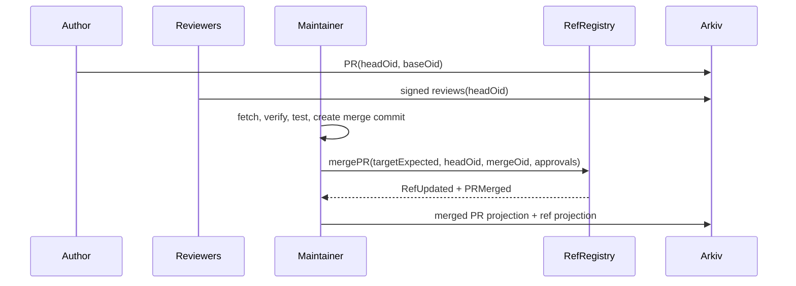
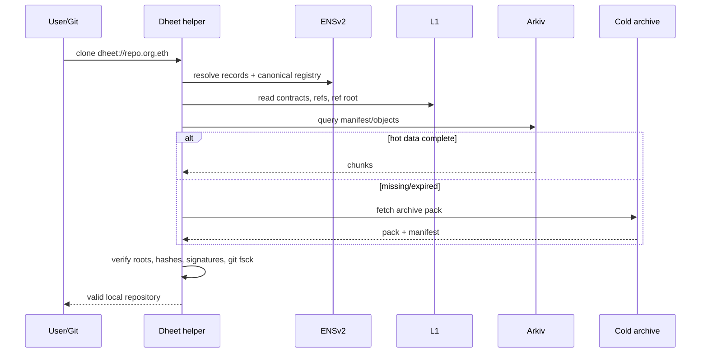
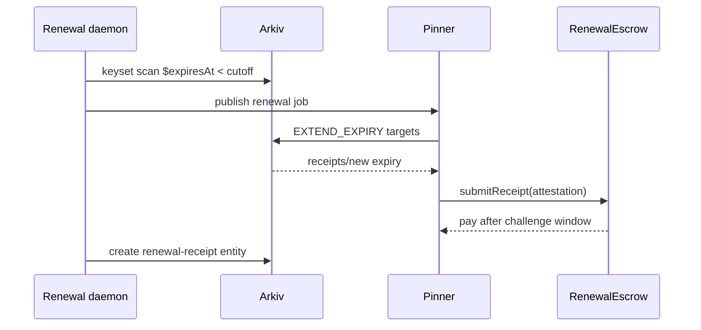

# Dheet: Implementation-Ready Protocol Plan

**Status:** architecture baseline for implementation  
**Target:** Git-compatible, decentralised version control and collaboration using Arkiv for hot queryable data, ENSv2 for names/identity/permissions, Ethereum L1 for authoritative concurrency and settlement, and content-addressed cold archives for permanence.

## 0. Decisions and invariants

The following choices resolve the source conflicts and are normative for Dheet v1.

1. **Git remains the compatibility boundary.** Dheet stores and serves canonical Git object bytes and packfiles. It does not invent a replacement commit graph.
2. **SHA-256 is Dheet's canonical digest; Git OIDs are retained.** `dheetOid = SHA-256("<type> <len>\0" || canonicalGitPayload)`. `gitOid` is the repository's native SHA-1 or SHA-256 OID. BLAKE3 is used for fast chunk verification and Merkle leaves, never as a substitute for a Git OID.
3. **Arkiv is not permanent storage.** The public SDK/current tokenomics reject permanent expiry even though an older API specification describes `MAX_EXPIRES_AT` as permanent. Dheet caps every create/extend at `7,884,000` blocks (about 182.5 days), renews before expiry, enables permissionless extension on durable entities, and requires cold-archive replication.
4. **Arkiv reads are untrusted in v1.** Although the API design discusses watcher proofs, the deployed read path does not yet provide a proof workflow suitable for clients. Every fetched object is content-hash verified; authoritative refs are checked against L1; multiple RPCs are compared where practical.
5. **Use only live Arkiv query features.** No `NOT`, `!=`, `BETWEEN`, cursor, history query, or multi-column order is required. Dheet uses positive predicates, one `ORDER BY`, a maximum `limit` of 100, and `$key` or monotonic `seq` keyset pagination.
6. **Registry identifiers are labelhash/resource, never token ID.** ENSv2 token IDs mutate on role changes and re-registration. Dheet persists the labelhash and resolves current token/resource at use time.
7. **Resolver argument permissions follow the contract-specific rule.** The general EAC page loosely describes resolver resources using namehash and record type; the Permissioned Resolver page defines the actual scheme as the setter argument alone (`keccak256(key)`, `keccak256(abi.encode(coinType))`, etc.). Dheet follows the latter and deploys one resolver per repository so a key-scoped grant cannot affect another repository.
8. **Do not hard-code a Sepolia deployment as truth.** Local materials contain deployment-era address sets. The CLI's 2026-10-01 set is a test fixture only. At runtime Dheet reads the Universal Resolver, requires `isENSv2()`, discovers `ROOT_REGISTRY()`, follows `getSubregistry("eth")`, checks it against `ETH_REGISTRY()` on the registrar, and verifies factory proxies with `verifyContract`. A signed deployment manifest pins the accepted addresses and code hashes per release.
9. **L1 is the single writer for shared refs.** Arkiv has no contracts and owner-gated patching cannot implement multi-writer compare-and-swap. `RefRegistry` on L1 authoritatively orders branch/tag updates; Arkiv stores immutable projections and bulk objects.
10. **No cross-chain atomicity is claimed.** Push is a resumable two-phase protocol: upload content, then commit the L1 ref CAS. An uploaded but unanchored pack is harmless garbage; an anchored update missing an Arkiv projection can be reconstructed from the L1 event and cold archive.

---

## 1. Vision, goals, non-goals, and personas

### Vision

Dheet makes a Git repository a self-verifying dataset with no mandatory hosting server. A user can resolve a repository from ENS, fetch its authoritative refs from Ethereum, obtain content from any Arkiv RPC, pinner, peer, or cold archive, verify every byte locally, and collaborate through signed append-only records.

### Goals

- Preserve normal Git workflows: clone, fetch, push, branches, annotated tags, shallow/partial clone, native signatures, and packfile efficiency.
- Remove the central repository server as an authority or availability dependency.
- Give organisations explicit, auditable ownership and roles through ENSv2 and L1 contracts.
- Make a repository recoverable after every Arkiv entity expires or a testnet is replaced.
- Support offline object verification and queued writes.
- Keep L1 writes small: names, role changes, ref CAS, roots, release attestations, escrow, and governance only.
- Make collaboration records portable and independently indexable.

### Non-goals for v1

- Replacing Git's merge semantics with a CRDT or Pijul-style patch algebra.
- Hiding all repository metadata for public repositories.
- Providing permanent storage solely through Arkiv.
- Serving arbitrary unverified executable hooks from the network.
- Guaranteeing instant global reads under RPC, L1, or archive outages.
- Running EVM contracts on Arkiv; Arkiv has no EVM.
- Supporting every forge feature in P1; Actions/CI runners, package registries, and large binary locking come later.

### Personas

| Persona | Primary job | Required properties |
|---|---|---|
| Solo developer | Publish and recover a project without maintaining a server | one-command init/push, wallet or local key signing, cheap renewals, cold backup |
| Maintainer | Review and merge changes from multiple writers | protected refs, CAS, role delegation, reproducible PR merge, audit trail |
| DAO/organisation | Govern repositories from a multisig | ENS namespace, EIP-1271, timelocked role changes, treasury-funded storage |
| Auditor | Verify historical source and release provenance | immutable objects, signed commits/tags/releases, L1 anchors, archive receipts, deterministic reconstruction |

## 2. Requirements

### Functional requirements

1. Initialise/import SHA-1 and SHA-256 Git repositories without rewriting existing history.
2. Resolve `dheet://repo.org.eth` to repository ID, contracts, current manifest, ref root, and archive locations.
3. Push only missing objects; fetch by negotiation or manifest; materialise a valid local Git object database.
4. Update refs with compare-and-swap, protected-branch policy, force-push controls, and monotonic sequence numbers.
5. Create forks, pull requests, reviews, issues, comments, releases, stars, and subscriptions as signed records.
6. Renew Arkiv entities automatically and allow independent pinners to extend eligible entities.
7. Recover hot state from a cold archive and L1 events after expiry or network replacement.
8. Support public and encrypted private repositories.
9. Produce unsigned L1 transaction payloads for hardware wallets/multisigs and optionally broadcast through a configured signer.

### Non-functional requirements and budgets

| Property | P1 target | P5 target |
|---|---|---|
| Integrity | all Git objects and chunks verified locally; refs verified against L1 | archive proofs and multi-RPC quorum; reproducible index checkpoints |
| Availability | clone works from any one healthy Arkiv RPC or cold archive | 3 independent pinners + 2 archive backends; measured 99.9% monthly retrieval |
| Censorship resistance | permissionless reads and archive mirrors; no exclusive gateway | permissionless pinning and relaying; documented self-host path |
| Cost per push | preflight estimate, default L1 batching, no per-object L1 writes | pack compaction, aggregate anchors, sponsored renewal policies |
| Latency | local commit unchanged; push reports upload and finality separately | optimistic UI <2 s, Arkiv availability <10 s, L1 safe confirmation policy configurable |
| Offline-first | read/commit/branch fully local; queue signed intents | conflict-aware sync daemon and delayed relayer submission |
| Compatibility | Git remote-helper clone/fetch/push | protocol v2 negotiation, partial clone, mirror bridge |
| Safety | object size/decompression/graph limits | fuzzed parsers, audited contracts, reproducible releases |

## 3. Layered architecture



Trust is deliberately split:

- **Git object store:** local source of bytes and Git semantics.
- **Arkiv:** queryable, expiring, replicated hot cache; never authoritative for shared ref ordering.
- **ENSv2:** human-readable discovery and delegated record administration.
- **L1 contracts:** repository identity, role policy, ref CAS, release roots, and funds.
- **Cold archive:** long-lived bulk bytes; integrity comes from Dheet/Git hashes, not provider trust.
- **Indexer:** performance aid only. Clients can replay L1 events and query Arkiv directly.

## 4. Arkiv data model

### 4.1 Encoding and common envelope

All durable entities are created with `readonly=true` and `permissionlessExtension=true`. Mutable UI state is represented as a new immutable snapshot/event with a higher L1-authorised `seq`; Dheet does not patch content records. Temporary upload leases may be non-readonly and owner-patched, but are outside the public protocol schema.

Attribute notation below is `name:type:indexed?`. `I` means indexed, `U` unindexed. Each entity has at most 32 attributes. Attribute names are ASCII and at most 32 bytes; strings are at most 128 UTF-8 bytes. A `bytes` value is never indexed and each operation stays below 128 KiB. Dheet chooses a conservative **120 KiB (`122,880` bytes) chunk payload** to leave calldata and metadata headroom.

Every entity includes this exact envelope:

| Attribute | Meaning |
|---|---|
| `v:u64:I` | schema version, initially `1` |
| `kind:str:I` | one of the schema names below |
| `repo:bytes32:I` | immutable `repoId = keccak256(chainId, RepoFactory, repoNonce)` |
| `seq:u64:I` | L1-assigned sequence for ordered records; `0` for immutable Git objects |
| `author:addr:I` | submitting identity/wallet |
| `ctime:u64:I` | Unix seconds supplied by client; informational, signed |
| `payloadHash:bytes32:I` | SHA-256 of canonical CBOR metadata plus content bytes |
| `sig:bytes:U` | EIP-712/EIP-1271 envelope or empty when signature is intrinsic to Git object |

Canonical metadata uses deterministic CBOR (RFC 8949 deterministic encoding). Git payloads remain byte-for-byte Git payloads; metadata never changes their OID. Compression is zlib for Git pack compatibility or zstd for archive bundles; `codec` identifies it. Decompression always enforces the declared `rawSize` before allocation.

### 4.2 Exact entity schemas

The following columns are added to the eight-field envelope.

| Entity | Additional attributes (exact) | Content |
|---|---|---|
| `commit` | `oid:bytes32:I`, `gitOid:bytes32:I`, `gitAlg:str:I`, `tree:bytes32:I`, `parent0:bytes32:I`, `parentRoot:bytes32:I`, `parentCount:u64:I`, `rawSize:u64:U`, `chunkCount:u64:I`, `codec:str:U`, `content:bytes:U` | canonical commit payload; `parent0=0` when root, full ordered parents remain in payload; `content` is empty and chunks are used when `chunkCount>0` |
| `tree` | `oid:bytes32:I`, `gitOid:bytes32:I`, `gitAlg:str:I`, `entryRoot:bytes32:I`, `entryCount:u64:I`, `rawSize:u64:U`, `chunkCount:u64:I`, `codec:str:U`, `content:bytes:U` | canonical binary tree payload; large trees use chunks because Git imposes no 128 KiB tree limit |
| `blob-chunk` | `oid:bytes32:I`, `gitOid:bytes32:I`, `gitAlg:str:I`, `objectKind:str:I`, `chunkNo:u64:I`, `chunkCount:u64:I`, `rawSize:u64:U`, `chunkSize:u64:U`, `chunkHash:bytes32:I`, `content:bytes:U` | contiguous canonical payload chunk; despite the schema's compatibility name, `objectKind` may be `blob`, `tree`, `commit`, or `tag`; `chunkHash=BLAKE3(content)` |
| `tag` | `oid:bytes32:I`, `gitOid:bytes32:I`, `gitAlg:str:I`, `targetOid:bytes32:I`, `targetKind:str:I`, `tagNameHash:bytes32:I`, `rawSize:u64:U`, `chunkCount:u64:I`, `codec:str:U`, `content:bytes:U` | canonical annotated-tag payload including native GPG/SSH signature; oversized tags use chunks |
| `ref` | `refKey:bytes32:I`, `refName:str:I`, `oldOid:bytes32:I`, `newOid:bytes32:I`, `manifest:bytes32:I`, `force:bool:I`, `anchorTx:bytes32:I`, `anchorBlock:u64:I`, `policyHash:bytes32:I`, `content:bytes:U` | deterministic CBOR copy of the `RefUpdated` event and proof material |
| `pack-manifest` | `oid:bytes32:I`, `packHash:bytes32:I`, `objectRoot:bytes32:I`, `chunkRoot:bytes32:I`, `objectCount:u64:I`, `packSize:u64:U`, `chunkSize:u64:U`, `codec:str:I`, `coldId:str:U`, `content:bytes:U` | CBOR object index: Git OID ↔ Dheet OID ↔ pack offset/type/base; ordered chunk hashes and Arkiv keys |
| `pr` | `prId:bytes32:I`, `sourceRepo:bytes32:I`, `sourceRef:bytes32:I`, `targetRef:bytes32:I`, `baseOid:bytes32:I`, `headOid:bytes32:I`, `state:str:I`, `mergeOid:bytes32:I`, `title:str:U`, `content:bytes:U` | snapshot/event body, labels, assignees, prior snapshot hash |
| `review` | `reviewId:bytes32:I`, `prId:bytes32:I`, `commitOid:bytes32:I`, `verdict:str:I`, `supersedes:bytes32:I`, `content:bytes:U` | review body and optional inline-comment root |
| `issue` | `issueId:bytes32:I`, `state:str:I`, `title:str:U`, `labelRoot:bytes32:I`, `assigneeRoot:bytes32:I`, `content:bytes:U` | issue body plus prior snapshot hash |
| `comment` | `commentId:bytes32:I`, `threadId:bytes32:I`, `parentId:bytes32:I`, `targetOid:bytes32:I`, `pathHash:bytes32:I`, `line:u64:I`, `content:bytes:U` | Markdown body; edit/delete is a signed superseding comment event |
| `renewal-receipt` | `target:key:I`, `targetHash:bytes32:I`, `oldExpiry:u64:I`, `newExpiry:u64:I`, `payer:addr:I`, `arkivTx:bytes32:I`, `amount:u256:U`, `content:bytes:U` | receipt, observed block, RPC set, pinner policy, optional cold-archive receipt |

`gitOid:bytes32` encodes a SHA-1 OID as twelve zero bytes followed by the 20-byte digest; SHA-256 occupies all 32 bytes. `gitAlg` disambiguates. `refName` is stored only if it fits 128 bytes; Dheet rejects longer refs at publication even though local Git may permit edge cases. `refKey = keccak256(UTF8(refName))` is the stable key.

### 4.3 Chunking, packs, deduplication, and deltas

1. Run `git pack-objects --revs --stdout` with a deterministic option profile recorded in the manifest. Git pack v2 bytes are the transport/archive form.
2. Parse and verify the pack locally. Reject delta depth over 50, object count over the requested budget, integer overflow, duplicate conflicting OIDs, path traversal in checkout, and decompression ratios over policy.
3. Store commits, trees, and tags directly when their compressed `content` fits 120 KiB. Otherwise set their metadata entity's `content` empty and `chunkCount>0`, then store ordered `blob-chunk` entities with the appropriate `objectKind`. Store every blob as chunks, including single-chunk blobs, so one code path handles range/lazy fetch.
4. A pack manifest records native `OBJ_OFS_DELTA`/`OBJ_REF_DELTA` mappings. Dheet may store the original pack chunks in cold storage but Arkiv blob chunks are reconstructed object payload chunks, avoiding an unusable delta when a base expires.
5. Deduplicate within a repository by `(repo, oid, chunkNo)`. Cross-repository global dedup is disabled for private repos and optional for public repos because it leaks object equality. Before upload, query existing chunks and verify `chunkHash`.
6. `objectRoot` is a Merkle root over sorted `(dheetOid, gitAlg, gitOid, type, rawSize)` leaves. `chunkRoot` is over ordered `(oid, chunkNo, chunkHash)` leaves. L1 anchors the manifest hash/root, not each object.

### 4.4 Write batches

Arkiv `execute(Operation[])` is atomic only within one transaction. Predicted keys use `predictEntityKeys`; predictions are invalidated if another create from the same account lands first, so the uploader reserves one account nonce lane and serialises its create transactions.

Per push:

1. **Object batches:** up to five 120 KiB chunk creates per transaction (lower if gas estimation says so), then small commit/tree/tag creates. All object creates are readonly + permissionless-extension.
2. **Manifest batch:** create one `pack-manifest` only after all chunk receipts are confirmed and locally re-read.
3. **L1 CAS:** call `RefRegistry.updateRef` with expected old OID and manifest root.
4. **Projection batch:** create the `ref` entity and optional PR/issue updates using the L1 event's sequence and transaction hash.
5. If step 3 fails, mark uploads locally as unreferenced; they remain deduplicated candidates until GC expiry. If step 4 fails, an indexer recreates it from the L1 event.

No push assumes atomicity across Arkiv and Ethereum.

### 4.5 Concrete queries and pagination

`arkiv_query` receives the query string separately from `{limit, select}`. Values below are fully typed and hexadecimal placeholders are exactly sized.

```sql
-- Find a commit by Dheet OID
kind = str('commit') AND repo = bytes32(0x<64hex>) AND oid = bytes32(0x<64hex>)

-- Fetch all chunks of one blob; chunkNo is unique and monotonic
kind = str('blob-chunk') AND repo = bytes32(0x<64hex>) AND oid = bytes32(0x<64hex>)
ORDER BY chunkNo:u64 ASC

-- Discover manifests newer than a local sequence
kind = str('pack-manifest') AND repo = bytes32(0x<64hex>) AND seq > u64(<lastSeq>)
ORDER BY seq:u64 ASC

-- Fetch a ref projection; client selects highest L1-verified seq from <=100 rows
kind = str('ref') AND repo = bytes32(0x<64hex>) AND refKey = bytes32(0x<64hex>)
ORDER BY seq:u64 DESC

-- Collaboration feed
repo = bytes32(0x<64hex>) AND seq > u64(<lastSeq>) AND kind = str('pr')
ORDER BY seq:u64 ASC

-- Renewal candidates owned by a pinner, with cutoff expressed as a block
$owner = addr(0x<40hex>) AND $expiresAt < u64(<cutoffBlock>)
ORDER BY $expiresAt:u64 ASC
```

For a full repository scan, use `{limit:100}` and stable keyset pagination:

```sql
repo = bytes32(0x<64hex>) AND $key > key(0x<lastEntityKey64hex>)
ORDER BY $key:key ASC
```

Start without the `$key` predicate; continue from the last returned key; stop on fewer than 100 rows. For event feeds, `seq > lastSeq ORDER BY seq ASC` is preferred because L1 guarantees unique repo sequence numbers. Offset pagination is allowed only for human UI pages, never replication. Dheet does not depend on expiry events; it maintains a local expiry heap from `$expiresAt` and periodically rescans.

### 4.6 Cost per push

Current V1 formulas:

```text
computeGas = max(21,000 + 4*tokens(calldata) + golemdbCost,
                 21,000 + 10*tokens(calldata))
tokens = zeroBytes + 4*nonZeroBytes
storageUnits = cellBytes*cellByteUnits + indexBytes*indexByteUnits
             + cells*c_cell + indexedCells*c_idx
storageGas = ceil(storageUnits * lifetimeBlocks * capacityRate / 1,000,000)
fee = (computeGas + storageGas) * effectiveGasPrice
```

Worked 1 MiB push assumptions: incompressible bytes, nine 120 KiB-or-smaller chunks, `capacityRate=14`, `7,884,000` blocks, 1 gwei, GLM=$0.10, and 12% metadata/index overhead.

| Component | Estimate |
|---|---:|
| Raw storage gas | `1,048,576 * 7,884,000 * 14 / 1e6 = 115,737,625 gas` |
| With 12% entity/index overhead | `129,626,140 gas` |
| Calldata floor, mostly nonzero | about `41,964,040 gas` plus ABI overhead |
| GolemDB + ABI safety allowance | `8,000,000 gas` (must be replaced by `eth_estimateGas`) |
| Total Arkiv gas | about `179.6M gas`, split across transactions |
| At 1 gwei | `0.1796 GLM`, about `$0.018` |

This is an engineering estimate, not a quote: the deployed genesis weights, base fee, compression ratio, indexed-cell count, and transaction encoding control the actual result. `dheet push --dry-run` must build exact calldata and call gas estimation for each batch. The current 30M block gas limit means a 1 MiB upload cannot be one transaction; five 120 KiB chunks are near 24.6M calldata-floor gas before storage, so the planner will commonly choose two-to-five chunks per transaction.

## 5. ENSv2 design

### 5.1 Namespace

```text
org.eth
└── repo.org.eth                   owned repo token in org UserRegistry
    ├── branch--main.repo.org.eth  optional protected-ref token/record
    ├── tag--v1-2-0.repo.org.eth   immutable release record
    └── fork--alice.repo.org.eth   fork discovery record
```

ENS labels are normalised with ENSIP-15 rules off-chain. Git `/` is encoded as `--s--`, literal `--` as `--d--`, and labels exceeding ENS limits use `<prefix>-<base32(refKey)[0:26]>`; the resolver record preserves the original ref name. Bulk branches and all object data stay off-chain. ENS subnames are created only for protected branches, public releases, and named forks, avoiding one L1 write per ordinary ref.

Each organisation has one `UserRegistry` under `org.eth`; each repository gets its own child `UserRegistry` and its own `PermissionedResolver`. This is intentionally more isolated than the default per-account resolver because resolver argument-scoped roles apply across all names served by that resolver instance.

### 5.2 Deployment sequence with real calls

1. Resolve ENSv2 contracts dynamically and verify deployment manifest/code hashes.
2. Deploy organisation resolver if absent:
   `VerifiableFactory.deployProxy(PERMISSIONED_RESOLVER_IMPL, resolverSalt, abi.encodeCall(PermissionedResolver.initialize, (grants, calls)))`, where `resolverSalt = uint256(keccak256(abi.encode(keccak256("OwnedResolver"), orgSafe, 0)))`.
3. Deploy organisation registry:
   `deployProxy(USER_REGISTRY_IMPL, registrySalt, abi.encodeCall(UserRegistry.initialize, (rootGrants)))`, where `registrySalt = uint256(keccak256(abi.encode(keccak256("UserRegistry"), namehash("org.eth"), 0)))`.
4. On the registry containing `org.eth`, call `setSubregistry(uint256(labelhash("org")), orgRegistry)` and set/verify the child registry's `setParent(parentRegistry,"org")` when authorised.
5. `RepoFactory.createRepo(orgRegistry, "repo", ownerSafe, policyHash, ensConfig)` deploys Dheet contracts, deploys the per-repo resolver and registry through the verified factory, then calls org registry `register("repo", ownerSafe, repoRegistry, repoResolver, ownerRoleBitmap, expiry)` through an authorised registrar adapter.
6. Grant the repo registrar adapter root roles with `repoRegistry.grantRootRoles(ROLE_REGISTRAR | ROLE_RENEW, repoRegistrar)`. The initial root grant must include the corresponding admin roles or this call cannot succeed.
7. Set records atomically in resolver initialisation where possible, otherwise call name-based setters: `setText(dnsName,"git.repo",...)`, `setText(...,"git.chain",...)`, `setText(...,"git.manifest",...)`, `setContenthash(dnsName, archiveContenthash)`.
8. Verify `VerifiableFactory.verifyContract(proxy)` and `UniversalHelper.findCanonicalRegistry(dnsName)` before displaying the repository as verified.

The client reuses `ensv2-env/ens-cli` calldata builders and its unsigned `{to,data,value}` convention. It never assumes that emitting `ProxyDeployed` alone proves the expected implementation; it verifies factory provenance and implementation/code hash.

### 5.3 Roles and bitmaps

Registry constants are exact ENSv2 values: registrar `1<<0`, register-reserved `1<<4`, set-parent `1<<8`, unregister `1<<12`, renew `1<<16`, set-subregistry `1<<20`, set-resolver `1<<24`, transfer-admin `(1<<28)<<128`, set-URI `1<<36`, upgrade `1<<124`; each regular role's admin is `role<<128`.

| Dheet role | ENSv2 grants | Dheet L1 grants |
|---|---|---|
| Owner | repo token setter roles + admins, transfer-admin; resolver all required roles/admins; registry root admins; upgrade during bootstrap | `DEFAULT_ADMIN`, policy admin, emergency pause, treasury; normally a Safe |
| Maintainer | name-scoped set-resolver, set-subregistry, renew; resolver `ROLE_SET_TEXT`, `ROLE_SET_CONTENTHASH`, `ROLE_LINK` only as needed | ref update, force push if policy permits, merge, PR/issue moderation |
| Writer | no broad resolver grant; optional `grantSetterRoles` for `git.head` in a dedicated resolver | update allowed branch namespaces, create collaboration records |
| Release signer | `grantSetterRoles` for `git.release`/specific text key; no link or upgrade | create release anchor and protected tag |
| Reader | no write role; private-repo key entitlement is separate | view/decryption-key membership commitment only |

Production bootstrap removes dangerous root setter roles once name-scoped ownership is configured. Releases advertised as immutable set the final contenthash/text records, then revoke the setter role **and admin**, and also revoke `ROLE_LINK`+admin and `ROLE_UPGRADE`+admin on that release resolver. Revoking only the setter is not a complete lock.

### 5.4 Records

| Record | Value |
|---|---|
| `git.repo` | `dheet:1:<chainId>:<repoFactory>:<repoId>` |
| `git.head` | default ref name plus `(seq, oid)` compact JSON |
| `git.manifest` | `arkiv://<chainId>/<manifestOid>` and cold fallback URI |
| `git.refroot` | latest L1 ref-state Merkle root and block |
| `git.contracts` | RepoFactory/RefRegistry addresses and deployment-manifest hash |
| `git.release` | latest signed release manifest digest |
| `contenthash` | preferred immutable web/archive snapshot (IPFS/Arweave contenthash) |
| `url` | static explorer URL |
| `agent-context` | compact Markdown/JSON describing Dheet operations and verification |
| `agent-endpoint[mcp]` | optional read-only repository MCP endpoint; never authoritative |

ENS writes are batched and occur on repository creation, default-head changes, periodic manifest checkpoints, releases, role changes, and recovery—not every push.

### 5.5 Registrar, transfer, expiry, reverse, and indexing

- Build `DheetRepoRegistrar` from the tutorial's thin registrar: validate labels/policy, collect optional fee, call `IPermissionedRegistry.register`, and expose renew. Grant it only `ROLE_REGISTRAR|ROLE_RENEW` at root.
- Subname expiry is at least 400 days and renewed when under 90 days. `.eth` has a 28-day grace period and subsequent 21-day decaying premium; anyone may renew. Treasury automation renews the parent early.
- Transfer requires current-owner `ROLE_CAN_TRANSFER_ADMIN`. Safe transfers additionally require emancipation and no third-party assignees. Organisation transfers go through a Safe/timelock and rotate Dheet admins atomically where possible.
- For an immutable release, revoke transfer-admin and setter/link/upgrade roles plus their admins only after archive replication and a dry-run verification.
- Author display uses Universal Resolver reverse resolution and then forward-verifies the address. At launch reverse writes remain on v1 infrastructure; Dheet treats future L2 reverse claims as optional display metadata.
- Index `ProxyDeployed`; `RegistryCreated`, `LabelRegistered`, `LabelReserved`, `LabelUnregistered`, `ExpiryUpdated`, `SubregistryUpdated`, `ResolverUpdated`, `TokenRegenerated`, `ParentUpdated`, `TokenResource`, `URIUpdated`; ERC-1155 transfers; registrar `CommitmentMade`, `NameRegistered`, `NameRenewed`; resolver `Linked`, `ResolverCreated`, `AddressUpdated`, `TextUpdated`, `DataUpdated`, `ContenthashUpdated`, `ABIUpdated`, `NameUpdated`, `InterfaceUpdated`, `ResourceArgument`; and `EACRolesChanged`.
- Key indexed role state by `(contract, resource)`. Follow `TokenRegenerated`; use resource/labelhash as stable identity. `SubregistryUpdated` is authoritative for parent→child; `ParentUpdated` is only a hint.

## 6. Identity and signing

### Identity binding

- Operational identity is an Ethereum address; human identity is a forward-and-reverse-verified ENS name.
- Git's embedded GPG/SSH/X.509 commit/tag signatures are preserved and verified normally.
- Dheet adds an optional EIP-712 attestation without changing Git bytes:

```text
DheetObject(repoId bytes32, dheetOid bytes32, gitOid bytes32, gitAlg uint8,
            objectType uint8, author address, keyEpoch uint64, issuedAt uint64)
DheetRef(repoId bytes32, refKey bytes32, oldOid bytes32, newOid bytes32,
         manifest bytes32, expectedSeq uint64, nonce uint256, deadline uint64)
DheetReview(repoId bytes32, prId bytes32, commitOid bytes32, verdict uint8,
            bodyHash bytes32, nonce uint256, deadline uint64)
```

- EOAs use ECDSA; contract wallets use EIP-1271; counterfactual accounts may include ERC-6492 envelopes. The L1 contract verifies signatures for state-changing actions. Offline tools verify EOA signatures directly and contract signatures against an archived L1 block/state snapshot or a trusted RPC at the pinned block.
- `keyEpoch` is maintained in `RepoAccess`. Rotation increments the epoch and emits `SigningKeyRotated(identity, oldKey, newKey, epoch)`. Attestations pin epoch and remain historically valid unless a revocation explicitly covers a time/range.
- Revocation is append-only: `(key, fromEpoch, effectiveBlock, reasonHash)`. It cannot rewrite old Git objects; policy decides whether a release signed before compromise remains accepted.
- Organisation ownership defaults to a Safe multisig. High-risk actions—upgrade, role-admin revocation, force push to protected refs, escrow withdrawal—use a timelock.

## 7. Consistency and concurrency

### Ref CAS

Authoritative state lives in L1 `RefRegistry`:

```text
updateRef(repoId, refKey, expectedOld, newOid, manifestRoot, objectProof,
          expectedSeq, flags, deadline, signature)
```

It requires the current `(oid,seq)` to equal `(expectedOld,expectedSeq)`, policy authorisation to pass, a Merkle `objectProof` showing the new object leaf is covered by `manifestRoot`, and nonce/deadline validity. It increments `seq`, updates the ref-state sparse Merkle root, and emits `RefUpdated`. `createRef`, `deleteRef`, and `updateRefs` are specialised/batch forms using the same checks.

### Push protocol



- Ordinary push must be fast-forward, checked locally and optionally by a policy proof/attested merge base. Protected refs require maintainer/release policy.
- Force push sets a flag and requires a separate capability; prior ref events remain on L1 and in archives.
- Concurrent writers race at CAS; exactly one succeeds. The loser fetches the winning head, rebases/merges, and retries with a new signature.
- Forks have distinct `repoId`s and contracts. A PR references `(sourceRepo, sourceRef, headOid)` and target repo/ref.
- Merge result is an ordinary Git merge commit. Dheet never auto-resolves textual conflicts differently from Git. PR merge checks the reviewed head, target expected old OID, required approvals, and CI attestations in one L1 call.
- Tags are refs. Protected/immutable releases prohibit replacement after publication.

### Finality and reorgs

- Record statuses are `pending`, `included`, `safe`, `finalized`. Defaults: UI optimistic at inclusion; push returns success only at `safe`; releases wait for `finalized` or a configurable confirmation threshold if the chain lacks tags.
- Store block hash with every anchor. On reorg, rewind indexer to the common ancestor, invalidate orphaned ref projections, and replay logs. Arkiv objects remain valid content-addressed data even if their anchor was orphaned.
- Arkiv finality is undocumented. The sync engine waits N blocks (initially 12, configurable), rereads through two RPCs when available, and treats content hashes—not RPC inclusion claims—as integrity evidence.
- A Rabdi network replacement invalidates all hot entity references. The chain fingerprint `(chainId, genesisHash, protocolDomain)` is part of local state; a changed fingerprint triggers recovery, never silent continuation.

## 8. Durability and economics

### Renewal service

- Every durable create uses maximum allowed lifetime and permissionless extension.
- Renewal windows: warn at 60 days remaining, schedule at 45 days, urgent at 14 days, recovery mode at 3 days.
- Owners fund a `RenewalEscrow`; registered pinners compete to submit extension receipts. The escrow pays a fixed reimbursement plus bounty only after an oracle/committee or signed client receipt confirms the Arkiv transaction and new expiry. Until Arkiv has trustless proofs, escrow payout is optimistic with a challenge window and bonded pinners.
- Anyone may extend permissionless entities directly even without reimbursement. Multiple pinners coordinate by reading latest expiry immediately before submitting; no-op equal extensions should be avoided.
- Renewal receipts are themselves archived; they are not relied on to keep the target alive.

### Storage tiers

| Tier | Contents | Retention/authority |
|---|---|---|
| Local | working tree, Git ODB, SQLite index, queued intents | user controlled |
| Arkiv hot | object chunks, manifests, collaboration projections | ≤182.5 days per purchase, continuously renewed |
| Ethereum L1 | repo identity, roles, refs/ref root, release roots, funds | authoritative and durable |
| Cold | packfiles, manifests, collaboration log, index checkpoints | at least two independent content-addressed systems |

Cold policy for protected refs/releases: IPFS CID pinned by three operators plus one paid durable backend (Arweave or Filecoin deal); Swarm is an optional second retrieval path. A release is “durable” only after two heterogeneous receipts verify.

### Recovery and GC

1. Resolve ENS and verify contracts.
2. Replay `RefRegistry` and release events to obtain live roots.
3. Fetch the latest signed archive manifest from `contenthash`/`git.manifest`.
4. Verify manifest, Git pack checksums, object graph, and ref reachability.
5. Recreate Arkiv entities with a new generation and write a recovery checkpoint; update ENS only after verification.

GC is reachability-based from current refs, retained releases, open PR heads, and policy retention windows. Local/cold compaction can discard unreachable objects after 90 days by default. Arkiv does not delete shared immutable objects early; it stops renewing them. Private encrypted chunks are deleted only by key destruction plus expiry; public data cannot be made secret again.

### Worked annual model

At the placeholder `capacityRate=14`, 2-second blocks, 1 gwei, and GLM=$0.10:

- 1 decimal GB-month raw storage: `18.144 GLM ≈ $1.81`.
- 1 GB-year raw storage: `217.728 GLM ≈ $21.77`; with 10% metadata/index overhead: about `239.5 GLM ≈ $23.95`.
- Initial 1 GB mostly-nonzero calldata floor is about `40 GLM ≈ $4.00`, excluding GolemDB work, so rough first-year Arkiv cost is **about 280 GLM / $28**, before congestion and compression.
- A 5+ character `.eth` parent is documented at $8/year for one year; repo subnames in Dheet's own registry have no ENS rent unless governance adds one, but they incur L1 gas. Three- and four-character parent names are far more expensive ($640/$160 per year baseline).
- L1 gas is quoted at action time. Product estimates must separate Arkiv GLM, Ethereum gas, ENS rent/payment token, cold-storage contracts, and pinner bounty.

These numbers are planning examples only; current Arkiv prices are explicitly uncalibrated and genesis-fixed.

## 9. L1 smart contracts

### Interfaces

```solidity
interface IRepoFactory {
  function createRepo(bytes32 orgId, string calldata label, address owner,
    bytes32 policyHash, ENSConfig calldata ens) external returns (bytes32 repoId, address refRegistry);
}

interface IRefRegistry {
  function updateRef(bytes32 repoId, bytes32 refKey, bytes32 expectedOld,
    bytes32 newOid, bytes32 manifestRoot, bytes32[] calldata objectProof,
    uint64 expectedSeq, uint32 flags, uint64 deadline, bytes calldata signature)
    external returns (uint64 newSeq, bytes32 refRoot);
  function updateRefs(RefUpdate[] calldata updates) external returns (bytes32 refRoot);
  function state(bytes32 repoId, bytes32 refKey) external view returns (bytes32 oid, uint64 seq, uint32 flags);
}

interface IRenewalEscrow {
  function deposit(bytes32 repoId) external payable;
  function submitReceipt(bytes32 repoId, bytes32 receiptHash, uint64 newExpiry,
    address pinner, bytes calldata attestation) external;
  function challenge(bytes32 receiptHash, bytes calldata evidence) external;
  function claim(bytes32 receiptHash) external;
}

interface IFundingEscrow {
  function createBounty(bytes32 repoId, bytes32 issueId, address token,
    uint256 amount, bytes32 termsHash) external returns (bytes32 bountyId);
  function release(bytes32 bountyId, address recipient, bytes32 resolutionOid,
    bytes[] calldata approvals) external;
  function refund(bytes32 bountyId) external;
}

interface IENSAccessAdapter {
  function syncRole(bytes32 repoId, bytes32 role, address account, bool enabled) external;
  function checkpointENS(bytes32 repoId, bytes32 manifest, bytes32 refRoot,
    bytes calldata resolverCalls) external;
}
```

Events: `RepoCreated`, `PolicyUpdated`, `RefUpdated`, `RefDeleted`, `ReleaseAnchored`, `SigningKeyRotated`, `KeyRevoked`, `RenewalFunded`, `RenewalReceiptSubmitted`, `RenewalReceiptChallenged`, `RenewalPaid`, `BountyCreated`, `BountyReleased`, `ENSCheckpointed`, and all role events.

### Design constraints

- `RepoFactory` is immutable or versioned; it creates minimal proxies/clones only for Dheet contracts and calls ENS's separate Verifiable Factory for ENS proxies.
- `RefRegistry` stores only current `(oid,seq,flags)` and aggregate root. Events carry history. Batch updates share one root update and transaction.
- `RepoAccess` uses explicit bitmaps with admin separation, maximum-scope checks, EIP-712 domain separation by chain and contract, per-signer nonces, and EIP-1271.
- Protected-branch policy is a small audited state machine: fast-forward attestation mode, required approvals, allowed signer set/root, force-push capability, timelock, and pause. Complex CI policy is represented by signed attestations, not arbitrary on-chain execution.
- Renewal payouts are not trustless until Arkiv write proofs exist; isolate this experimental contract and cap exposure.
- Use pull payments, checks-effects-interactions, reentrancy guards, SafeERC20, bounded arrays, and no unbounded on-chain loops.

### Upgrade and audit strategy

- Core `RefRegistry` v1 is non-upgradeable; migrations deploy v2 and require an explicit repo governance transaction plus ENS checkpoint. Funds contracts may use UUPS behind a Safe+timelock with immutable emergency caps.
- ENS UserRegistry/Resolver proxies remain UUPS but production owners may revoke upgrade+admin for immutable releases.
- Foundry layout: `contracts/src/{factory,refs,access,escrow,ens,lib,interfaces}`, `test/{unit,fuzz,invariant,fork}`, `script`, `deployments/<chain>.json`.
- Audit surface is kept to ref CAS/signature verification, role transitions, ENS adapter calls, escrow accounting, upgrade authorisation, and migration. Git parsing and Arkiv encoding are audited separately in TypeScript/Rust client code.

## 10. Client and Git integration

### Commands

```text
dheet init [--name repo.org.eth]
dheet clone dheet://repo.org.eth [path] [--depth N] [--filter blob:none]
dheet push [remote] [refspec] [--dry-run] [--wait safe]
dheet pull|fetch [remote] [refspec]
dheet fork repo.org.eth --as fork-name
dheet pr create|show|list|checkout|merge
dheet review approve|request-changes|comment
dheet issue create|show|list|close
dheet release create <tag> --immutable
dheet renew [--all] [--fund amount]
dheet whois <name|address|repoId>
dheet verify [--full] [--at block]
dheet recover <name> [--from ipfs://...]
dheet daemon start|status|stop
```

### `git-remote-dheet`

- Registered by executable naming convention; URLs are `dheet://repo.org.eth` or `dheet::<repoId>`.
- P0 implements remote-helper `capabilities`, `list`, `fetch`, and `push`; use `connect`/protocol-v2 only after correctness is proven.
- `list` is built from L1 ref state/index checkpoint, not an Arkiv mutable ref.
- `fetch <oid> <name>` computes missing reachability, downloads verified chunks/packs in parallel, and feeds `git index-pack --stdin --fix-thin` or writes verified loose objects.
- `push <src>:<dst>` receives local OIDs, generates a pack with Git plumbing, uploads, submits CAS, and prints Git-standard `ok`/`error` status. Non-fast-forward maps to Git's expected rejection.
- Object format capability is detected from `extensions.objectFormat`; mixed SHA-1/SHA-256 repos use Git's compatibility mapping, never naive digest substitution.

### Local state

SQLite tables: repositories, contracts, refs, objects, chunks, manifests, entities/expiry, L1 cursor+block hashes, ENS records, signatures, archive receipts, queued operations, and peer/RPC health. Bytes live in Git ODB/cache, not SQLite. Every cache row has source chain fingerprint and verification status.

The daemon renews, watches L1/Arkiv events, repairs missing projections, pins requested repositories, uploads archives, and emits desktop/webhook notifications. It never holds a wallet key by default; it queues unsigned payloads or uses an explicitly configured signer.

The TypeScript SDK exposes pure codecs/hash/verification, Arkiv adapters, ENS discovery, L1 clients, and sync orchestration. CLI output has human and stable JSON modes. ENS operations reuse ens-cli modules for calldata, including predicted proxy addresses and unsigned signing flows.

## 11. Collaboration layer

- **PR:** immutable snapshots keyed by `prId=keccak256(repo,creator,nonce)`. State transitions require author/maintainer policy. Merge binds exact target old OID and reviewed head OID.
- **Reviews:** signed decisions against an exact commit; a newer review may supersede but not erase the earlier one. Required approvals are evaluated at merge.
- **Issues/comments:** append-only snapshots/events. Moderation hides content in indexes/UI but cannot erase public bytes; moderation decisions are signed.
- **Releases:** annotated Git tag + release manifest + archive receipts + L1 `ReleaseAnchored`; optional locked ENS subname.
- **Stars/forks:** stars are low-value signed entities with short TTL and no mandatory renewal; forks are real repos with `upstreamRepo` metadata.
- **Notifications:** local/indexer-derived subscriptions; no on-chain write per notification. Delivery can use Web Push/email/Matrix but is non-authoritative.
- **Funding/bounties:** terms hash references issue/PR and payout conditions; escrow release references merged/released Git OID.

PR merge sequence:



## 12. Web UI

A static Next.js/Vite-compatible explorer reads Arkiv, ENSv2, and L1 directly; an indexer endpoint is an optional acceleration layer. Use ENSjs **5.2.5 or newer**, viem, wagmi, TanStack Query, and wallet connectors. The UI:

- resolves and verifies canonical registry/proxy provenance;
- displays pending/safe/finalized state explicitly;
- verifies object/chunk hashes in a Web Worker;
- lazily loads blobs/diffs with byte and line limits;
- generates unsigned or wallet-submitted transactions;
- warns when reading one RPC, stale ENS records, unfinalized refs, expiring data, or archive under-replication;
- can export a complete verification report and clone command.

No server-side secret is required for public browsing. Access keys for higher Arkiv RPC quotas are user/project configuration and are origin-restricted; they are not embedded in public bundles.

## 13. Privacy

### Public repositories

Everything is readable; encryption is absent. Authors must assume Git history and collaboration metadata are permanent once archived.

### Private repositories

- Encrypt each pack/object chunk using XChaCha20-Poly1305 with random content keys and random nonces; hash ciphertext for storage identity while retaining plaintext Git OIDs inside the encrypted manifest.
- Envelope-encrypt repository epoch keys to reader X25519 keys. Wallets sign the binding from Ethereum identity to encryption key. Reader membership is a Merkle root on L1; key envelopes live in Arkiv/cold storage.
- Rotate epoch keys on membership change; new content uses the new epoch. Revocation cannot retract previously downloaded plaintext.
- Disable cross-repo dedup and deterministic encryption. Pad chunk lengths into buckets for sensitive repos.
- Private ref names, object counts, update timing, author addresses, entity ownership, ciphertext sizes, ENS name, and L1 activity still leak. A stealth/unlisted mode can replace descriptive ENS records with opaque IDs but cannot hide chain traffic.
- Search/indexing happens locally or in a trusted enclave/service; public indexers see only ciphertext metadata.

## 14. Threat model

| STRIDE | Threat | Mitigation | Residual risk |
|---|---|---|---|
| Spoofing | fake ENS/repo/indexer | canonical registry walk, factory/code-hash verification, EIP-712 signatures, forward-verified reverse ENS | compromised ENS owner can repoint future discovery |
| Spoofing | signer/key compromise | Safe, hardware keys, epochs, revocation, timelock, branch policy | attacker can act until revocation/finality |
| Tampering | malicious Git object/chunk/pack | recompute Git+Dheet+BLAKE3 hashes, pack checksum, fsck, bounded parser | parser implementation bugs |
| Tampering | lying Arkiv RPC/indexer | L1 ref authority, content hashes, multi-RPC comparison, replayable events | availability and omission remain possible |
| Tampering | front-running ref update | expected old+seq CAS, signer nonce/deadline, transaction privacy optional | public pending updates reveal intent |
| Repudiation | denied review/push | typed signatures, L1 events, immutable snapshots | contract-wallet policy may change; historical state needed |
| Information disclosure | private metadata/equality | ciphertext OIDs, random encryption, padding, no global dedup | timing/size/address leakage persists |
| Denial of service | entity flooding/index poisoning | require repo/signature/policy, quotas, bounded query, local validation, ignore unanchored entities | public Arkiv capacity can still be congested |
| Denial of service | decompression bomb/huge graph | declared-size caps, streaming decode, delta-depth/object-count/CPU budgets | carefully crafted near-limit packs consume resources |
| Denial of service | TTL griefing/no renewal | permissionless extension, multiple pinners, escrow, early renewal, cold recovery | network replacement loses all hot state |
| Denial of service | ENS expiry/takeover | early auto-renew, Safe treasury, alerts, recovery aliases | parent `.eth` loss can redirect discovery |
| Elevation | EAC admin mistake | generated role plan, simulation, invariant tests, two-step lock, max-scope lint | irreversible admin revocation can brick changes |
| Elevation | unsafe resolver delegation | resolver-per-repo, argument-scoped grants, revoke link/upgrade for locks | root grants remain broad within that resolver |
| Availability | sequencer centralisation/reorg | local/offline operation, cold mirrors, L1 anchors, confirmation policy | Arkiv hot writes can halt or censor temporarily |
| Economic | storage/gas spike | dry-run quote, caps, batching, compression, relayers, treasury policy | user may be unable to afford timely renewal |

## 15. Scalability

- Indexer ingests L1 with block-hash checkpoints and dynamic ENS proxy discovery, Arkiv events with periodic reconciliation, and archive manifests. PostgreSQL stores projections; object bytes remain content-addressed storage.
- Every API response includes source block, finality, ref root, and verification status. Index checkpoints are signed and anchored but optional.
- Cache by immutable OID forever; cache refs only by `(blockHash,seq)`. Use CDN/IPFS for public pack chunks.
- Shallow clone walks commit parents to depth; partial clone supports `blob:none`, `blob:limit`, sparse path filters, and lazy blob fetch. Reachability summaries/Bloom filters in manifests accelerate negotiation but are never trusted for correctness.
- Upload chunks concurrently across accounts only when key prediction/nonces are isolated; default concurrency 4 and adapt to RPC 429/error rates.
- Respect Arkiv public RPC access-key quotas. Rotate across user-configured providers only according to terms; self-host for high-volume indexers.
- Backpressure limits: 100 query rows, 16 concurrent downloads, 4 uploads, 512 MiB default pack, 2 GiB single blob opt-in, bounded PR diff. Limits are configurable but explicit.
- Periodic pack compaction consolidates reachable objects and publishes a new manifest; old packs age out after all retained roots are covered.

## 16. Interoperability

- Import reads existing refs/objects and publishes without rewriting. Export fetches all reachable objects and emits a normal bare Git repository/bundle.
- GitHub/GitLab bridge runs bidirectionally with loop-prevention trailers and mapping `(forge,event/id) ↔ Dheet record`. Mirroring is an availability feature, never authority.
- `dheet mirror github owner/repo` can import issues/PRs as signed bridge records that clearly identify the bridge signer and source URL.
- CI hooks are signed attestations over `(repoId,commitOid,workflowHash,result,artifactRoot)`. Protected policy names accepted issuers; runner logs/artifacts use cold storage.
- Webhooks are generated from L1/Arkiv/indexer events with replay IDs. Local `post-receive` compatibility runs only user-approved local commands.
- Radicle informs peer replication and signed collaboration objects; git-ssb informs append-only social discovery; Gitopia informs chain+archive collaboration; Pijul's patch algebra is deliberately not adopted because Git semantics are a hard requirement.

## 17. Technology and monorepo

```text
packages/
  cli/                 dheet command and JSON interface
  remote-helper/       git-remote-dheet
  sdk/                 codecs, hashes, clients, verification
  sync/                planner, uploader, fetcher, recovery
  indexer/             L1/ENS/Arkiv projections and API
  web/                 static explorer and wallet UX
  contracts/           Foundry workspace
  git-fixtures/        SHA-1/SHA-256 packs and adversarial corpora
  e2e/                 Kurtosis + Anvil orchestration
docs/                  protocol, ADRs, threat model, operations
```

Initial pinned baseline, locked exactly in lockfiles: Bun 1.3.6, TypeScript 5.9.3, viem 2.52.2, `@arkiv-network/sdk` 1.0.1, ENSjs 5.2.5+, wagmi 3.7.11, Solidity 0.8.30, OpenZeppelin 5.x matching ENS contracts-v2, Foundry pinned by commit, Node 22 LTS for distribution, PostgreSQL 17, SQLite 3. All protocol ABIs and deployment manifests are vendored with source commit hashes.

Local development:

- Arkiv: `docs/arkiv/arkiv-node/scripts/kurtosis/up.py` two-node sequencer/follower devnet plus Bun SDK integration tests.
- ENS/L1: adapt `ensv2-env/ens-cli/e2e/harness.ts` to Anvil forks; use local deployed Dheet contracts and verified ENSv2 addresses.
- Full e2e: orchestrator starts Arkiv Kurtosis, Anvil, local IPFS, two identities, indexer, and CLI.
- Rabdi: chain 7794095, `https://rpc.rabdi.db-chain.testnet.arkiv.network`, test tGLM from hub faucet; access key via `x-api-key`/SDK configuration for elevated quotas.

Scaffold repairs before feature work:

1. Replace `simple-subname-registrar/src/Counter.sol`, test, and script with `DheetRepoRegistrar` based on the tutorial.
2. Upgrade `ensv2-env/app` from ENSjs 4.2.3 to 5.2.5+ and align viem versions.
3. Extract ens-cli's contract config/calldata modules into a reusable package rather than shelling out.
4. Add deployment-manifest verification and remove address duplication from e2e tests.
5. Add workspace tooling, CI, formatting, typecheck, Foundry, and reproducible e2e commands.

## 18. Phased roadmap and exit criteria

| Phase | Scope | Exit criteria |
|---|---|---|
| P0 spike | one Git commit/tree/blob on Rabdi; repo name on Sepolia | bytes round-trip and `git fsck`; ENS canonical registry/proxy verified; written cost report |
| P1 single-user | init/import, remote-helper list/fetch/push, manifests, local cache | clone→edit→push→fresh clone matches; SHA-1 and SHA-256 fixtures; no central service |
| P2 identity/roles | RepoFactory/Access, ENS registry/resolver, signatures, Safe flow | two roles allowed/denied correctly; key rotation; unsigned Safe transaction works |
| P3 multi-user refs/forks | RefRegistry CAS, protected refs, force policy, forks | deterministic concurrent-push winner; loser recovers; reorg test; fork PR head fetch |
| P4 collaboration | PR/review/issues/comments/releases/bounties | reviewed exact head merges atomically; moderation and event replay tested |
| P5 durability | daemon, pinners, renewal escrow, two cold backends, recovery | expire/wipe Arkiv and restore complete repo from L1+cold; 3-pinner drill |
| P6 web UI | static explorer, wallet writes, diff/blob views | browser verifies hashes and finality; no mandatory backend; accessibility/performance budgets pass |
| P7 audit/mainnet | audits, bug bounty, governance, mainnet deployment | two independent audits, critical findings fixed, reproducible release, runbooks and emergency drill |

Every phase ships an ADR, threat-model delta, cost benchmark, and rollback/recovery procedure.

## 19. Testing and acceptance

### Test pyramid

- **Unit:** deterministic CBOR, OID conversion, Git pack/delta parsing, chunk planning, query rendering, EIP-712 domains, ENS name encoding.
- **Property/fuzz:** arbitrary Git DAG round-trip; Merkle roots independent of upload order; chunk split/join; malformed pack rejection; ref CAS state machine; EAC role transitions.
- **Foundry:** access control, EIP-1271, nonces/deadlines, batch CAS, force policy, pause, escrow accounting, upgrade/migration, ENS fork integration.
- **Integration:** Arkiv create/query/keyset/expiry/permissionless extension; predicted keys under nonce races; RPC disagreement; ENS factory deploy and canonical verification.
- **Differential:** generated repositories compared with `git cat-file`, `index-pack`, `verify-pack`, `fsck`, clone/fetch/push behavior.

### Mandatory two-identity e2e

```text
Alice: dheet init --name demo.alice.eth
Alice: git commit && git push dheet main
Bob:   git clone dheet://demo.alice.eth
Bob:   git checkout -b feature && git commit && git push dheet feature
Bob:   dheet pr create --base main --head feature
Alice: dheet review approve <pr>
Alice: dheet pr merge <pr>
Bob:   git fetch dheet && git merge --ff-only dheet/main
Assert: both Git ODBs fsck; L1 head=mergeOid; Arkiv projection seq matches; archive pack verifies.
```

### Chaos suite

- Expire all Arkiv entities; stop one/both nodes; return stale/omitted rows; replace genesis fingerprint.
- Reorg L1 before safe/finalized, duplicate logs, and restart indexer from checkpoints.
- Race two pushes, signer rotation, role revocation, ENS resolver replacement, `.eth` nearing expiry.
- Corrupt/truncate/swap chunks, malicious delta chains, compression bombs, oversized attributes, duplicate OIDs.
- Archive gateway outage and dishonest receipt; renewal pinner no-op/double claim.

Phase acceptance tests are the exit criteria in section 18 and run in CI where deterministic. Rabdi/Sepolia smoke tests run nightly with spend caps; local forks run on every merge.

## 20. Risks, governance, licensing, and decision log

### Risk register

| Risk | Likelihood/impact | Owner | Trigger and response |
|---|---|---|---|
| Arkiv API/genesis changes | high/high | protocol | chain fingerprint/version mismatch → halt writes, migrate adapter, recover from cold |
| Arkiv economics uncalibrated | high/medium | product | estimate exceeds cap → compress, shorten hot set, sponsor, delay push |
| No trustless Arkiv read/write proofs | high/high | protocol | conflicting RPCs → L1/cold verification, quarantine escrow payouts |
| ENSv2 deployment/API churn | medium/high | identity | manifest/code mismatch → read-only mode and governance update |
| L1 fees too high | medium/high | contracts | batch roots/refs, sponsor relayer, evaluate L2 only in a future protocol version |
| Renewal operational failure | medium/critical | SRE | urgent threshold → permissionless campaign; cold recovery |
| Contract vulnerability | low/critical | security | pause policy actions, preserve reads, deploy versioned migration |
| Client parser vulnerability | medium/critical | security | sandbox parsing, size limits, coordinated release |
| Indexer centralisation | medium/medium | ecosystem | ship self-host image and direct-read mode; multiple public indexers |
| Private metadata leakage | high/medium | privacy | document limits, padding/stealth mode, avoid false confidentiality claims |

### Governance and licensing

- Protocol specs/ADRs: CC0 or CC-BY-4.0; client/indexer/web: Apache-2.0 or MIT; contracts: MIT. Dependencies are reviewed for compatibility, especially Git implementations and ENS contracts.
- Dheet Improvement Proposals (DIPs) govern wire/schema changes. Consensus-critical changes require specification, vectors, two implementations or one implementation plus independent review, migration plan, and activation block/version.
- Repo-level governance is owner-defined (EOA, Safe, DAO timelock). Protocol deployment manifests are signed by a release multisig and reproducibly generated.
- Security council may pause shared infrastructure and vulnerable optional contracts, but cannot alter repository objects or refs without repo-specific authority.

### ADR decision log

| ADR | Choice | Rejected alternative | Why |
|---|---|---|---|
| 001 | Git object semantics | new patch/CRDT VCS | immediate compatibility and mature tooling |
| 002 | SHA-256 Dheet digest + Git OID mapping | BLAKE3-only OID | Git SHA-1/SHA-256 interoperability; BLAKE3 retained for chunks |
| 003 | L1 RefRegistry CAS | Arkiv mutable ref | Arkiv has no contracts/multi-writer CAS |
| 004 | immutable Arkiv projections | patch shared entities | owner-gated patches and no history queries make append-only safer |
| 005 | renewable Arkiv + cold archive | “permanent” Arkiv entity | current network rejects permanence and can be replaced |
| 006 | resolver per repo | resolver per account/org | argument-scoped roles apply across an instance |
| 007 | sparse aggregate ref root | L1 write per object | lower gas while retaining authoritative refs |
| 008 | dynamic ENS discovery + signed manifest | hard-coded Sepolia addresses | deployment sets conflict/change |
| 009 | two-phase push | claimed cross-chain atomicity | honest failure semantics and resumability |
| 010 | event-derived notifications | on-chain inbox writes | cost and spam resistance |

## 21. Appendices

### A. Glossary

- **Dheet OID:** SHA-256 of canonical Git object header+payload used as protocol-wide 32-byte key.
- **Git OID:** native SHA-1 or SHA-256 identifier used by the repository.
- **Manifest:** immutable mapping of objects/chunks/archives committed by a Merkle root.
- **Projection:** non-authoritative Arkiv copy of an L1 event for query speed.
- **Ref root:** sparse Merkle root of current L1 ref state.
- **Pinner:** permissionless actor that extends Arkiv expiry and/or retains cold data.
- **Canonical registry:** ENS registry whose upward and downward hierarchy links agree.
- **Safe/finalized:** chain-specific confirmation stages, distinct from optimistic inclusion.

### B. Sample Arkiv entity JSON

```json
{
  "$key": "0xaaaaaaaaaaaaaaaaaaaaaaaaaaaaaaaaaaaaaaaaaaaaaaaaaaaaaaaaaaaaaaaa",
  "$owner": "0x1111111111111111111111111111111111111111",
  "$expiresAt": "0x7a4d20",
  "$creationFlags": { "readonly": true, "permissionlessExtension": true },
  "attributes": {
    "v": { "type": "u64", "indexed": true, "value": "0x1" },
    "kind": { "type": "str", "indexed": true, "value": "blob-chunk" },
    "repo": { "type": "bytes32", "indexed": true, "value": "0x<64hex>" },
    "seq": { "type": "u64", "indexed": true, "value": "0x0" },
    "author": { "type": "addr", "indexed": true, "value": "0x1111111111111111111111111111111111111111" },
    "ctime": { "type": "u64", "indexed": true, "value": "0x690d5f80" },
    "payloadHash": { "type": "bytes32", "indexed": true, "value": "0x<64hex>" },
    "sig": { "type": "bytes", "indexed": false, "value": "0x..." },
    "oid": { "type": "bytes32", "indexed": true, "value": "0x<64hex>" },
    "gitOid": { "type": "bytes32", "indexed": true, "value": "0x000000000000000000000000<40hex>" },
    "gitAlg": { "type": "str", "indexed": true, "value": "sha1" },
    "chunkNo": { "type": "u64", "indexed": true, "value": "0x0" },
    "chunkCount": { "type": "u64", "indexed": true, "value": "0x9" },
    "rawSize": { "type": "u64", "indexed": false, "value": "0x100000" },
    "chunkSize": { "type": "u64", "indexed": false, "value": "0x1e000" },
    "chunkHash": { "type": "bytes32", "indexed": true, "value": "0x<64hex>" },
    "content": { "type": "bytes", "indexed": false, "value": "0x..." }
  }
}
```

### C. Sample ENS record set

```text
repo.org.eth
  git.repo      = dheet:1:1:0xRepoFactory:0xRepoId
  git.head      = {"ref":"refs/heads/main","seq":42,"oid":"0x..."}
  git.manifest  = arkiv://7794095/0xManifestOid ipfs://bafy...
  git.refroot   = {"block":23456789,"root":"0x..."}
  git.contracts = {"refRegistry":"0x...","manifest":"0xDeploymentManifestHash"}
  contenthash   = ipfs://bafy...
  url           = https://explorer.dheet.dev/repo.org.eth
  agent-context = Dheet repository. Verify ENS, L1 ref root, manifest, then Git OIDs.
```

### D. Clone sequence



### E. Renewal sequence



### F. Authoritative local sources

Arkiv core:

- `docs/arkiv/arkiv-node/README.md`
- `docs/arkiv/arkiv-node/docs/api-spec.md`
- `docs/arkiv/arkiv-node/docs/query-language-conformance.md`
- `docs/arkiv/arkiv-node/docs/genesis-spec.md`
- `docs/arkiv/arkiv-node/docs/tokenomics_v1.md`
- `docs/arkiv/sites/docs.arkiv.network/start-here/{introduction,access-keys,clients,first-entity}.md`
- `docs/arkiv/sites/docs.arkiv.network/networks/{rabdi,older-networks}.md`
- `docs/arkiv/sites/docs.arkiv.network/json-rpc/{mutating-entities,querying-data}.md`
- `docs/arkiv/sites/docs.arkiv.network/reference/{limits,errors,query-language}.md`
- `docs/arkiv/sites/docs.arkiv.network/querying/{filter,select,sort,paginate,count,get-entity,without-schema,watch-events}.md`
- `docs/arkiv/sites/docs.arkiv.network/writing/{create,change,batches,expiration}.md`
- `docs/arkiv/sites/hub.arkiv.network/{networks,access-keys,faucet}.html`

ENSv2 (every file reviewed):

- `docs/ensv2/{overview,registry-hierarchy,permissioned-registry,enhanced-access-control,permissioned-resolver,subnames,verifiable-factory,mutable-token-ids,universal-resolver-v2,reverse-resolution,indexing,eth-registrar,migration,registry-template,erc1155-singleton,dns-resolvers,tutorial-app-developers,tutorial-contract-developers,building-with-ai}.mdx`
- `docs/ensv2/{ensip-25,ensip-26,ens-cli-README,ens-cli-AGENTS,ens-cli-CLAUDE}.md`
- `ensv2-env/ens-cli/README.md`
- `ensv2-env/ens-cli/src/commands/*.ts`
- `ensv2-env/ens-cli/src/lib/{contracts,v2,records,context,client}.ts`
- `ensv2-env/ens-cli/e2e/{harness,sepolia.test,mainnet.test}.ts`
- `ensv2-env/app/{package.json,check.ts}`
- `ensv2-env/simple-subname-registrar/{README.md,src/Counter.sol,test/Counter.t.sol}`

Web references used to verify gaps/freshness:

- Git remote helpers: `https://git-scm.com/docs/gitremote-helpers`
- Git pack format: `https://git-scm.com/docs/pack-format`
- Git protocol v2 and packfile URIs: `https://git-scm.com/docs/protocol-v2`
- Git SHA-256 transition: `https://git-scm.com/docs/hash-function-transition`
- Radicle Heartwood: `https://github.com/radicle-dev/heartwood`
- git-ssb/SSB application background: `https://github.com/ssbc/handbook.scuttlebutt.nz/blob/master/applications.md`
- Gitopia: `https://github.com/gitopia/gitopia`
- Pijul: `https://pijul.org/`

### G. Open questions with decision deadlines

1. Can Arkiv expose verifiable query membership/non-membership proofs and write receipts? Decide before RenewalEscrow leaves experimental status.
2. What are calibrated Rabdi/mainnet storage weights and practical throughput for 120 KiB chunks? Benchmark in P0.
3. Should canonical Dheet OID include Git type/length exactly as Git does or use a versioned CBOR wrapper? Baseline chooses exact Git framing; freeze with vectors in P0.
4. Which cold pair is default: IPFS+Filecoin, IPFS+Arweave, or Swarm+Arweave? Select by P5 based on retrieval/SLA/cost tests.
5. Can a succinct fast-forward/reachability proof be added economically, or should protected branches rely on maintainer attestations? Prototype in P3.
6. What maximum object/blob sizes are acceptable in public gateways? Set from parser and browser benchmarks in P1.
7. Is L1 mainnet cost acceptable, or does a future version anchor batches through an Ethereum-secured L2? Do not change authority layer before P3 measurements.
8. Which ENS deployment manifest governance and code-hash policy survives proxy upgrades without unsafe auto-acceptance? Resolve before P2.
9. What legal/privacy policy applies to encrypted illegal content that permissionless pinners cannot inspect? Resolve before public pinning incentives.
10. What pinner attestation quorum is acceptable until Arkiv proofs exist? Keep escrow capped until answered.

## First 10 tasks to start tomorrow

1. Create the monorepo workspaces and pin the baseline toolchain/lockfiles.
2. Write protocol test vectors for SHA-1 Git OID, SHA-256 Git OID, Dheet OID, BLAKE3 chunk hash, and manifest Merkle roots.
3. Implement a read-only P0 pack parser/chunker and verify output with `git index-pack`, `verify-pack`, and `fsck`.
4. Start the Arkiv Kurtosis devnet and prove create→query→keyset-page→extend for one readonly permissionless entity.
5. Upload and reconstruct one real commit/tree/blob on Rabdi, recording exact gas and storage-unit measurements.
6. Replace the Counter scaffold with `DheetRepoRegistrar` interfaces, role constants, and Foundry tests.
7. Extract reusable unsigned-calldata and deployment-discovery code from `ensv2-env/ens-cli`.
8. Build an Anvil Sepolia-fork test that deploys/validates one repo UserRegistry and per-repo PermissionedResolver through VerifiableFactory.
9. Specify and implement the minimal non-upgradeable `RefRegistry` CAS contract with fuzz/invariant tests.
10. Wire a vertical CLI spike: `dheet init` → Arkiv upload → L1 ref anchor → fresh verified clone, and publish the measured P0 report.
